# Backend Architecture & APIs — Diagrams

Sơ đồ kiến trúc và API của backend, vẽ từ **code hiện tại** (controller, `SecurityConfig`, `notification/`, `storage/`,
`application.yml`) chứ không phải từ `blueprint.md`. Dùng Mermaid nên xem trực tiếp trên GitHub / IntelliJ / VS Code.
Sơ đồ C4 cũ ở `docs/c4/` chưa có Redis, S3, SQS, email và các module workflow (proposal, review, defense...), nên file này
là bản cập nhật.

Mục lục: [1. Tổng quan](#1-tổng-quan-hệ-thống) · [2. Package](#2-package--module-map) · [3. Request pipeline & bảo mật](#3-request-pipeline--bảo-mật) ·
[4. API theo module](#4-api-map-theo-module) · [5. Phân quyền](#5-ma-trận-phân-quyền-rbac) · [6. Luồng đặt lịch](#6-luồng-đặt-slot-chống-over-booking) ·
[7. Sự kiện & thông báo](#7-sự-kiện--thông-báo) · [8. Vòng đời nghiệp vụ](#8-vòng-đời-nghiệp-vụ) · [9. Triển khai](#9-triển-khai)

---

## 1. Tổng quan hệ thống

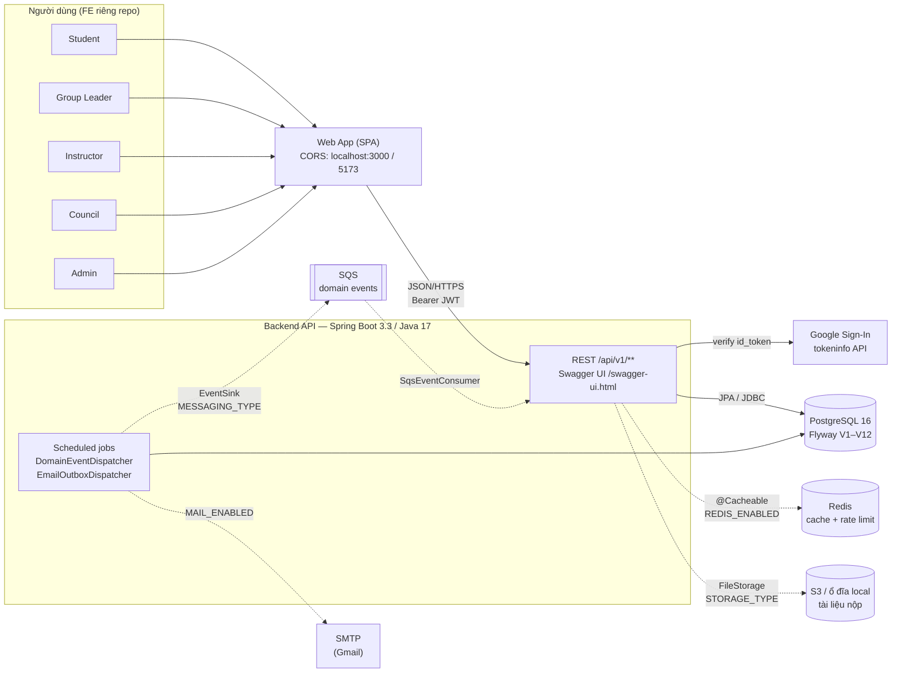

Nét đứt = thành phần **tuỳ chọn**, bật bằng biến môi trường. Mặc định chỉ cần PostgreSQL
(`STORAGE_TYPE=local`, `MESSAGING_TYPE=inprocess`, `CACHE_TYPE=none`, `MAIL_ENABLED=false`).

---

## 2. Package / module map

Package-by-feature dưới `com.capstone.tracking`; mỗi module gồm `Controller → Service → Repository → Entity (+ dto/)`.

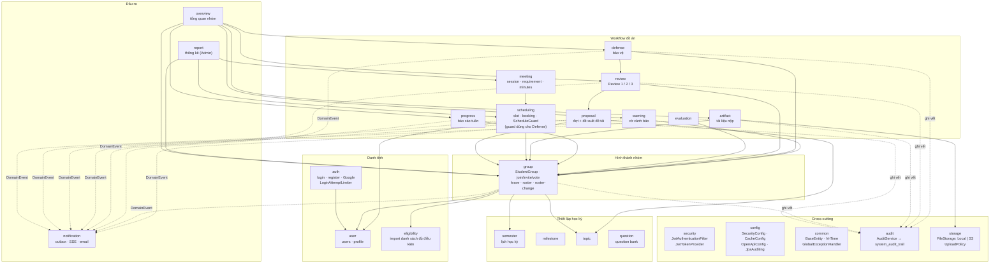

Mũi tên liền = phụ thuộc nghiệp vụ chính (không liệt kê hết); nét đứt = phát sự kiện / ghi audit.

---

## 3. Request pipeline & bảo mật

### 3.1 Đường đi của một request

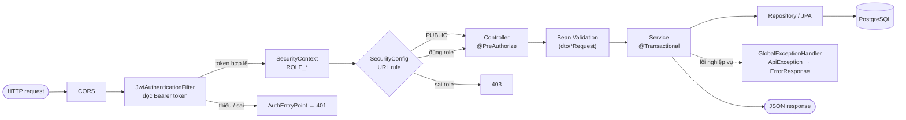

- **Stateless**: không session, CSRF tắt, mọi request mang `Authorization: Bearer <JWT>`.
- **Public**: `/api/v1/auth/{register,login,google,campuses}`, `/swagger-ui/**`, `/v3/api-docs/**`, `/actuator/health`.
- **Mọi role đã đăng nhập**: `/auth/me`, `/eligibility/me`, `/me/**`, `/notifications/**`, nhóm tham gia/lời mời/rời nhóm.
- Còn lại: kiểm tra theo `@PreAuthorize` trên từng endpoint (xem [mục 5](#5-ma-trận-phân-quyền-rbac)).

### 3.2 Đăng nhập (mật khẩu hoặc Google)

```mermaid
sequenceDiagram
    autonumber
    actor U as User
    participant FE
    participant AC as AuthController
    participant AS as AuthService
    participant L as LoginAttemptLimiter<br/>(Redis | in-memory)
    participant GV as GoogleTokenVerifier
    participant DB as PostgreSQL

    alt POST /auth/login
        FE->>AC: email + password
        AC->>AS: login()
        AS->>L: đã sai ≥ 5 lần / 15 phút?
        L-->>AS: chặn → 429 TOO_MANY_LOGIN_ATTEMPTS
        AS->>DB: tìm user, so BCrypt
        AS->>L: ghi nhận lần sai / reset khi đúng
    else POST /auth/google
        FE->>AC: Google id_token
        AC->>AS: loginWithGoogle()
        AS->>GV: verify (tokeninfo)
        GV-->>AS: GoogleIdentity (email)
        AS->>DB: tìm user theo email (miền cho phép: fpt.edu.vn)
    end
    AS-->>FE: LoginResponse { accessToken, role, ... }
    Note over FE,AC: Các request sau gửi Bearer token;<br/>GET /auth/me trả về profile hiện tại
```

---

## 4. API map theo module

Tất cả bắt đầu bằng `/api/v1`. Swagger UI liệt kê đầy đủ request/response. Viết tắt role: **AD**=Admin, **IN**=Instructor,
**CO**=Council, **GL**=Group Leader, **ST**=Student, **\***=mọi role đã đăng nhập.

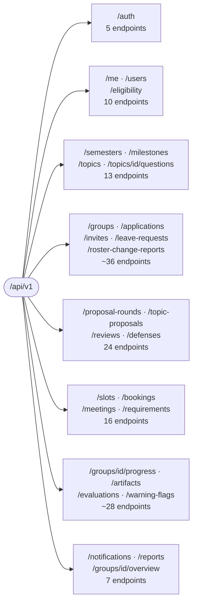

### 4.1 Auth & Identity

| Method | Path | Role | Mô tả |
|---|---|---|---|
| POST | `/auth/register` | public | Đăng ký (giới hạn miền email) |
| POST | `/auth/login` | public | Đăng nhập, trả JWT |
| POST | `/auth/google` | public | Đăng nhập bằng Google id_token |
| GET | `/auth/campuses` | public | Danh sách campus |
| GET | `/auth/me` | \* | Người dùng hiện tại |
| POST / GET | `/users` | AD | Tạo / liệt kê user |
| GET / PUT | `/users/{id}` | AD | Xem / sửa user |
| GET / PUT | `/me/profile` | \* | Hồ sơ cá nhân |
| POST | `/eligibility/import` | AD | Import danh sách đủ điều kiện |
| PUT | `/eligibility/{userId}` | AD | Sửa trạng thái đủ điều kiện |
| GET | `/eligibility/ineligible` | AD | Danh sách không đủ điều kiện |
| GET | `/eligibility/me` | \* | Tình trạng của tôi |

### 4.2 Thiết lập học kỳ

| Method | Path | Role | Mô tả |
|---|---|---|---|
| PUT / GET | `/semesters/{semester}` | AD / \* | Lịch học kỳ |
| GET / PUT | `/semesters/{semester}/join-settings` | AD | Cấu hình tham gia nhóm |
| POST / GET | `/milestones`, GET `/milestones/{id}` | AD / \* | Mốc tiến độ (cache Redis) |
| POST / GET | `/topics`, GET/PUT `/topics/{id}` | AD (ghi) / \* (đọc) | Đề tài |
| POST / GET | `/topics/{topicId}/questions` | AD, GL / \* | Question bank |

### 4.3 Hình thành nhóm (`group`)

| Method | Path | Role | Mô tả |
|---|---|---|---|
| POST / GET | `/groups` | AD, ST, GL / \* | Tạo / liệt kê nhóm |
| GET / PUT | `/groups/{id}` | \* / AD | Chi tiết / cập nhật |
| POST | `/groups/{id}/members` | AD | Thêm thành viên (tối đa 5 active) |
| DELETE | `/groups/{id}/members/{memberId}` | AD, GL | Xoá thành viên |
| PUT | `/groups/{id}/leader` | AD | Đổi trưởng nhóm |
| POST | `/groups/{id}/lock` · `/unlock` | AD | Khoá / mở nhóm |
| POST | `/groups/{id}/roster/submit` | GL | Gửi danh sách cho GVHD |
| POST | `/groups/{id}/roster/review` | IN, AD | Duyệt / từ chối danh sách |
| POST | `/groups/{gid}/applications` | ST | Xin vào nhóm |
| GET | `/groups/{gid}/applications` · `/me/applications` | GL / ST | Xem đơn |
| POST | `/applications/{id}/approve` · `/reject` · `/withdraw` | GL / ST | Xử lý đơn |
| POST / GET | `/applications/{id}/votes` | thành viên | Bỏ phiếu cho đơn |
| POST / GET | `/groups/{gid}/invites` | GL | Mời / xem lời mời |
| POST | `/invites/{id}/accept` · `/decline` · `/revoke` | ST / GL | Phản hồi lời mời |
| GET | `/me/invites` | ST | Lời mời của tôi |
| POST / GET | `/groups/{gid}/leave-requests` | thành viên | Xin rời nhóm |
| POST | `/leave-requests/{id}/approve` · `/reject` · `/withdraw` | GL / ST | Xử lý đơn rời |
| POST / GET | `/groups/{gid}/roster-change-reports` | IN (tạo), IN+AD (xem) | Báo cáo thay đổi nhân sự |
| GET | `/roster-change-reports` | AD | Tất cả báo cáo |
| POST | `/roster-change-reports/{id}/resolve` | AD | Giải quyết |

### 4.4 Đề tài, Review, Bảo vệ

| Method | Path | Role | Mô tả |
|---|---|---|---|
| POST / GET | `/proposal-rounds` | AD / \* | Mở / xem đợt đề xuất |
| PUT | `/proposal-rounds/{id}/close` | AD | Đóng đợt |
| POST / GET | `/groups/{gid}/topic-proposals` | GL / \* | Nộp / xem đề xuất của nhóm |
| GET | `/topic-proposals`, `/topic-proposals/{id}` | IN, CO, AD / \* | Danh sách / chi tiết |
| POST | `/topic-proposals/{id}/forward` | IN, AD | GVHD chọn 1 đề tài chuyển Hội đồng |
| POST | `/topic-proposals/{id}/decision` | CO, AD | Hội đồng duyệt / từ chối |
| POST | `/reviews` · `/reviews/clone` | AD | Lên lịch / nhân bản lịch Review |
| GET | `/reviews`, `/reviews/mine`, `/reviews/{id}`, `/groups/{gid}/reviews` | theo role | Xem Review |
| POST | `/reviews/{id}/result` · `/revision-complete` | IN, CO, AD | Kết quả / hoàn tất chỉnh sửa |
| POST | `/defenses` · `/defenses/rolling` | AD | Lên lịch bảo vệ (đơn / cuốn chiếu) |
| GET | `/defenses`, `/defenses/mine`, `/defenses/{id}`, `/groups/{gid}/defenses` | theo role | Xem buổi bảo vệ |
| POST | `/defenses/{id}/result` | IN, CO, AD | Ghi kết quả đậu / rớt |

### 4.5 Lịch hẹn & họp

| Method | Path | Role | Mô tả |
|---|---|---|---|
| POST | `/slots` | IN, AD | Mở slot |
| GET | `/slots`, `/slots/{id}` | \* | Tìm / xem slot (cache) |
| POST | `/slots/{id}/book` | GL | Đặt slot (khoá hàng) |
| DELETE | `/bookings/{id}` | GL, IN, AD | Huỷ lịch |
| POST | `/bookings/{bookingId}/meetings` | GL, IN | Tạo phiên họp |
| GET | `/meetings/{id}` | \* | Xem phiên họp |
| PUT | `/meetings/{id}/start` · `/end` | GL, IN | Bắt đầu / kết thúc |
| POST / GET | `/meetings/{id}/requirements` | GL, IN / \* | Ghi yêu cầu |
| PUT | `/requirements/{id}` | GL, IN | Cập nhật yêu cầu |
| POST | `/meetings/{id}/minutes/generate` | GL, IN | Sinh biên bản (theo template) |
| PUT | `/meetings/{id}/minutes/sign` | GL, IN, AD | Ký biên bản 2 bên |
| GET | `/meetings/{id}/minutes` | \* | Xem biên bản |

### 4.6 Theo dõi tiến độ

| Method | Path | Role | Mô tả |
|---|---|---|---|
| POST / GET | `/groups/{gid}/progress` | GL / \* | Nộp / xem báo cáo tuần |
| GET | `/groups/{gid}/progress/summary` | \* | Tóm tắt tiến độ |
| GET / PUT | `/progress/{id}` | \* / GL | Chi tiết / sửa |
| PUT | `/progress/{id}/feedback` | IN, AD | Nhận xét |
| POST / GET | `/groups/{gid}/artifacts` (alias `/documents`) | GL / \* | Nộp (multipart) / liệt kê tài liệu |
| GET | `/artifacts/{id}`, `/artifacts/{id}/file` | \* | Metadata / tải file |
| POST | `/artifacts/{id}/accept` | IN, AD | Chấp nhận |
| PUT | `/artifacts/{id}/feedback` | IN, AD | Nhận xét |
| POST / GET | `/groups/{gid}/evaluations` | IN / \* | Chấm điểm 3 tiêu chí |
| GET | `/evaluations/{id}` | \* | Chi tiết |
| POST / GET | `/groups/{gid}/warning-flags` | IN, AD / \* | Cờ cảnh báo |
| PUT | `/warning-flags/{id}/resolve` | IN, AD | Gỡ cờ |

### 4.7 Đầu ra

| Method | Path | Role | Mô tả |
|---|---|---|---|
| GET | `/groups/{gid}/overview` | \* | Tổng quan nhóm |
| GET | `/reports/summary` | AD | Thống kê toàn học kỳ |
| GET | `/notifications` · `/unread-count` | \* | Danh sách / số chưa đọc |
| GET | `/notifications/stream` | \* | SSE realtime |
| PUT | `/notifications/{id}/read` · `/read-all` | \* | Đánh dấu đã đọc |

---

## 5. Ma trận phân quyền (RBAC)

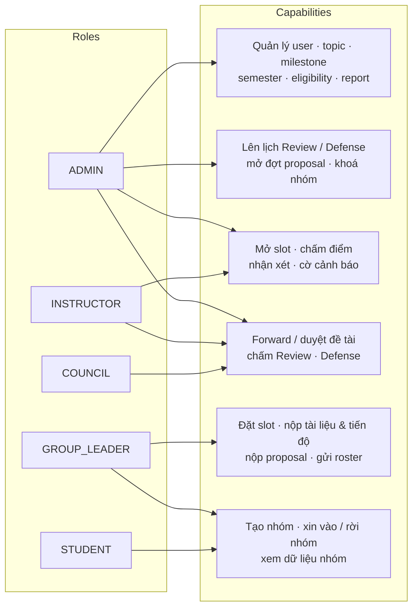

| Nhóm quyền | AD | IN | CO | GL | ST |
|---|:-:|:-:|:-:|:-:|:-:|
| User / Topic / Milestone / Semester / Eligibility / Report | ✅ | | | | |
| Mở đợt proposal, lên lịch Review/Defense, khoá nhóm | ✅ | | | | |
| Mở slot, nhận xét tiến độ/tài liệu, chấm điểm, cờ cảnh báo | ✅ | ✅ | | | |
| Forward đề tài, duyệt roster | ✅ | ✅ | | | |
| Duyệt đề tài, ghi kết quả Review/Defense | ✅ | ✅ | ✅ | | |
| Đặt slot, nộp tài liệu/tiến độ/proposal, gửi roster | | | | ✅ | |
| Tạo nhóm, xin vào/rời nhóm, xem dữ liệu nhóm | ✅ | ✅ | ✅ | ✅ | ✅ |

> Tóm tắt từ `@PreAuthorize` trong các controller; chi tiết từng endpoint ở mục 4.

---

## 6. Luồng đặt slot (chống over-booking)

Hai Group Leader cùng đặt slot cuối. `BookingService.book()` khoá hàng nhóm (`studentGroupService.lockById`) rồi khoá hàng
slot (`findByIdForUpdate`) nên các lần đặt cùng slot được **tuần tự hoá**; người đến sau thấy slot đầy và nhận 409.
(`ScheduleGuard`, khoá lịch toàn cục, hiện chỉ do `DefenseService` dùng khi xếp lịch bảo vệ.)

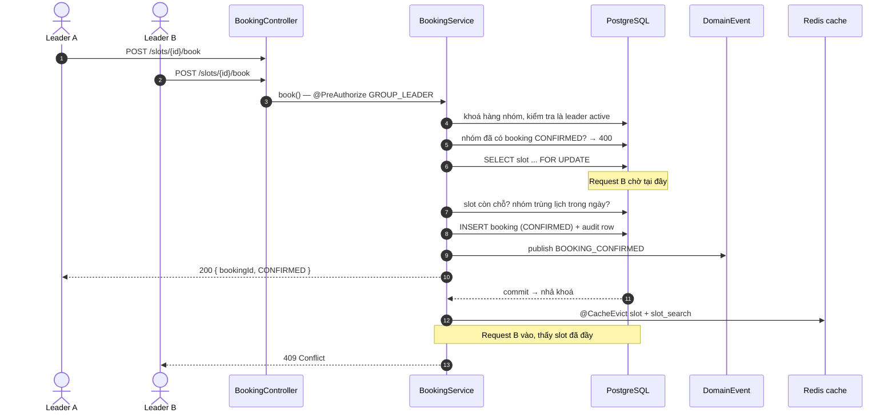

---

## 7. Sự kiện & thông báo

Service chỉ phát `DomainEvent`. Sự kiện được **lưu vào outbox cùng transaction** rồi mới gửi đi sau commit; lỗi thì
`DomainEventDispatcher` retry với exponential backoff (tối đa 1 giờ).

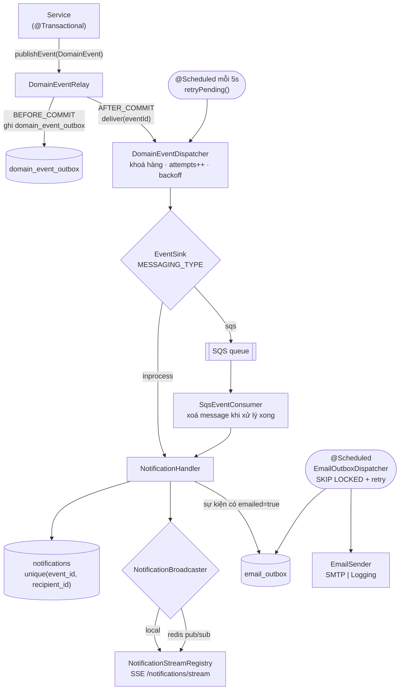

- **Idempotent**: nhận trùng message không tạo thông báo trùng nhờ unique `(event_id, recipient_id)`.
- **Email**: chỉ các event có cờ `emailed` (vd `TOPIC_APPROVED`, `REVIEW_RESULT`, `DEFENSE_SCHEDULED`, `DOCUMENT_FEEDBACK`...);
  To = leader, CC = thành viên + GVHD. `MAIL_ENABLED=false` thì chỉ ghi log.
- 29 loại event trong `DomainEventType`.

---

## 8. Vòng đời nghiệp vụ

### 8.1 Pipeline đồ án

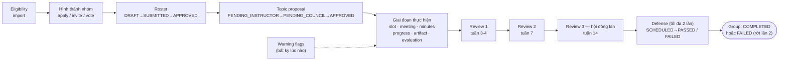

### 8.2 Trạng thái các thực thể chính

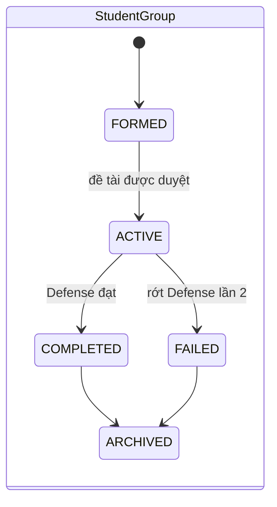

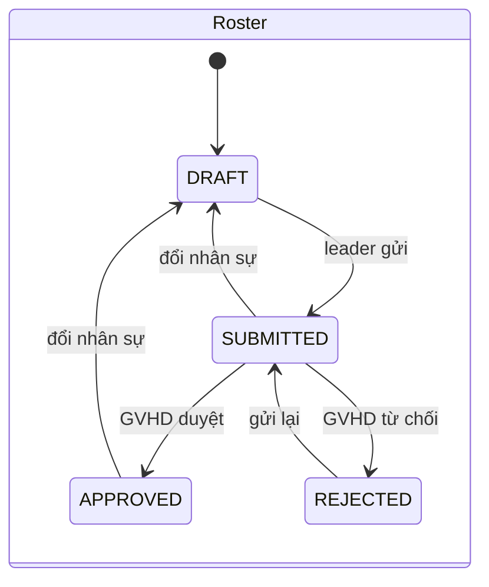

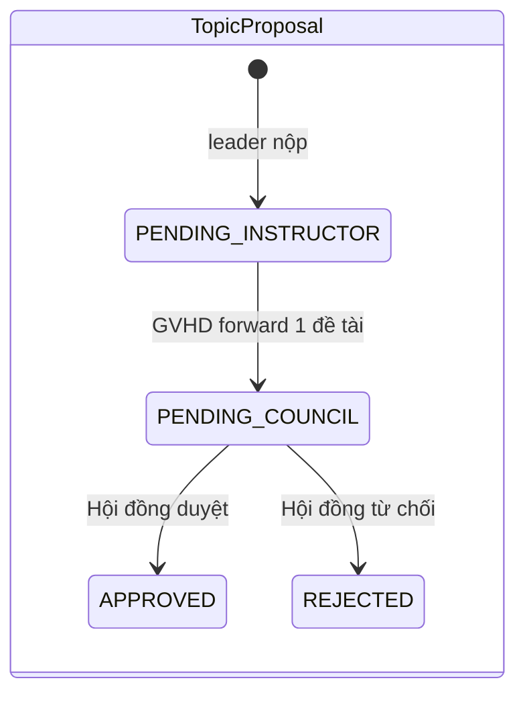

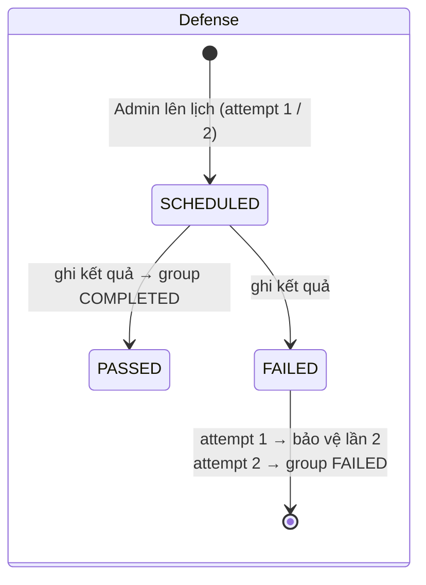

---

## 9. Triển khai

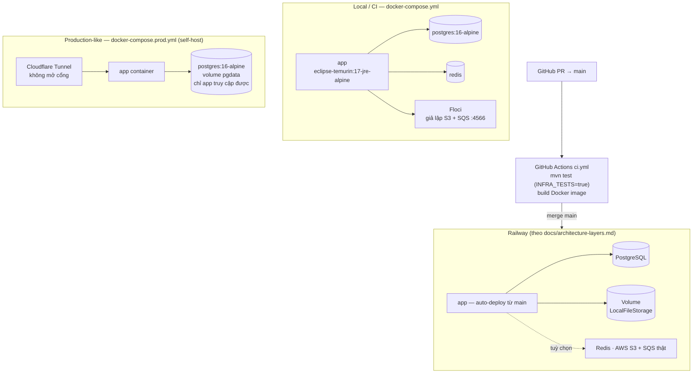

| Thành phần | Công nghệ |
|---|---|
| Runtime | Java 17, Spring Boot 3.3 (Web, Security, Data JPA, Validation, Scheduling, Cache) |
| DB & migration | PostgreSQL 16, Flyway (`db/migration` V1–V12; seed dev ở `db/seed`), `ddl-auto=validate` |
| Auth | JWT (jjwt), BCrypt, Google tokeninfo, rate-limit đăng nhập (Redis / in-memory) |
| Lưu trữ file | `FileStorage` → `LocalFileStorage` hoặc `S3FileStorage` (`UploadPolicy`: dung lượng, đuôi file) |
| Bất đồng bộ | Outbox + `EventSink` (in-process hoặc SQS), SSE, email outbox |
| Tài liệu API | springdoc OpenAPI — `/swagger-ui.html`, `/v3/api-docs` |
| Test | JUnit + MockMvc integration test; test hạ tầng (Floci, Redis) và Postgres chạy khi bật cờ |

Chi tiết bật/tắt từng phần: xem [`architecture-layers.md`](architecture-layers.md). ERD: [`erd.mmd`](erd.mmd).
