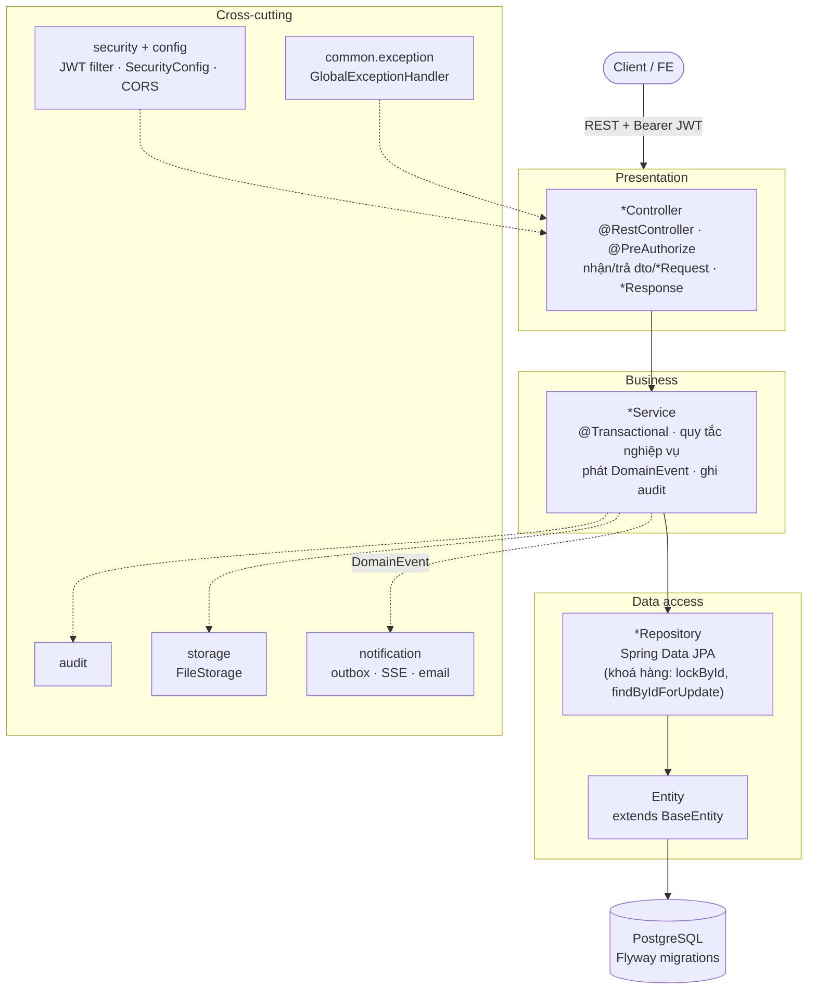
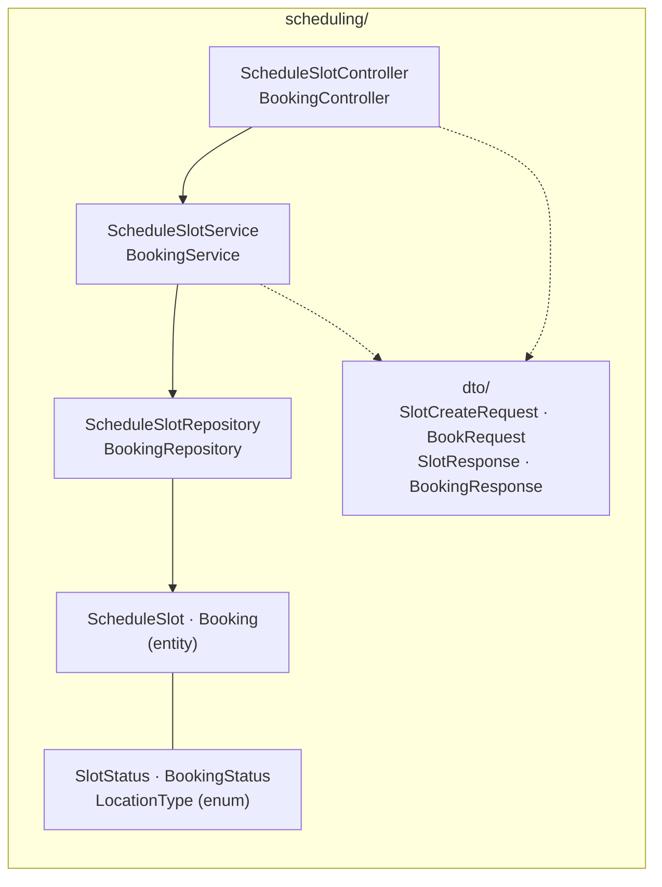
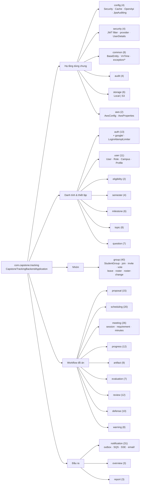
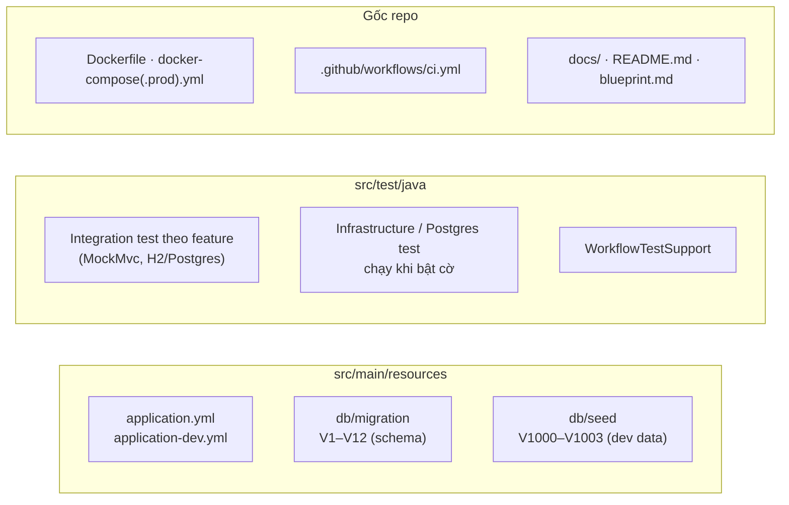

# Backend được tổ chức như thế nào

Sơ đồ cấu trúc nội bộ của backend (`com.capstone.tracking`), vẽ từ cây thư mục `src/main/java` thực tế.
Phần luồng chạy, API và sự kiện nằm ở [`backend-architecture-and-apis.md`](backend-architecture-and-apis.md).

## 1. Kiến trúc phân tầng

Một monolith Spring Boot, chia **theo feature** (package-by-feature), bên trong mỗi feature chia **theo tầng**.

Quy ước: `Controller` không chứa nghiệp vụ; `Service` giữ transaction và quy tắc; `Repository` chỉ truy vấn;
entity không bao giờ trả thẳng ra ngoài mà đi qua DTO.

## 2. Cấu trúc bên trong một module

Mọi feature đều theo cùng một khuôn (ví dụ `scheduling/`):

| Thành phần | Vai trò |
|---|---|
| `XxxController` | Route `/api/v1/...`, kiểm quyền, validate DTO |
| `XxxService` | Nghiệp vụ, transaction, event, audit |
| `XxxRepository` | Spring Data JPA |
| `Xxx` (entity) + `XxxStatus` (enum) | Mô hình dữ liệu và trạng thái |
| `dto/` | Request/Response, tách khỏi entity |

## 3. Bản đồ package

Số trong ngoặc là số file `.java` của package.

## 4. Tài nguyên và test ngoài `src/main/java`

