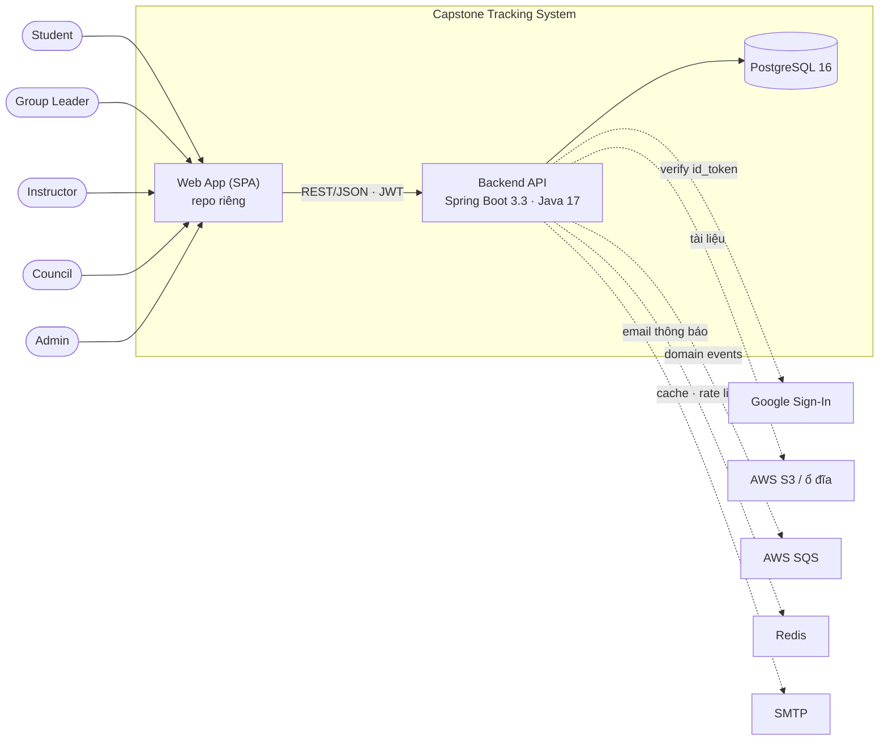
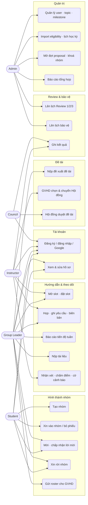
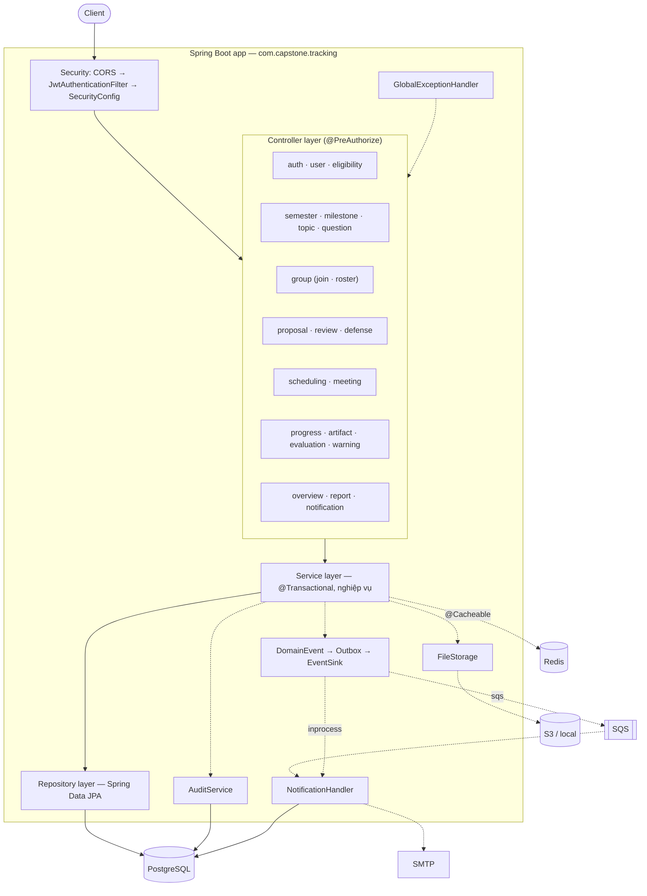

# Capstone Tracking Backend — Sơ đồ toàn bộ dự án (Mermaid)

Bộ sơ đồ tổng thể, vẽ từ code và migration Flyway hiện tại (V1–V12). Chi tiết hơn:
[`backend-organization.md`](backend-organization.md) (cấu trúc code) ·
[`backend-architecture-and-apis.md`](backend-architecture-and-apis.md) (luồng, API, RBAC, sự kiện).

| # | Sơ đồ | Trả lời câu hỏi |
|---|---|---|
| 1 | System Context | Hệ thống phục vụ ai, nói chuyện với gì? |
| 2 | Use case theo vai trò | Mỗi role làm được gì? |
| 3 | Quy trình đồ án end-to-end | Một nhóm đi qua những bước nào, ai tham gia? |
| 4 | Kiến trúc backend | Các tầng, module, hạ tầng ghép với nhau thế nào? |
| 5 | ERD đầy đủ | 33 bảng liên kết ra sao? |

---

## 1. System Context



---

## 2. Use case theo vai trò



---

## 3. Quy trình đồ án end-to-end

```mermaid
sequenceDiagram
    autonumber
    actor AD as Admin
    actor ST as Student / Leader
    actor IN as Instructor
    actor CO as Council
    participant SYS as Hệ thống

    rect rgb(235,245,255)
    Note over AD,SYS: Chuẩn bị học kỳ
    AD->>SYS: import eligibility, lịch học kỳ, milestone, topic
    end

    rect rgb(240,255,240)
    Note over ST,SYS: Hình thành nhóm
    ST->>SYS: tạo nhóm / xin vào / mời (tối đa 5 thành viên)
    ST->>SYS: Leader gửi roster
    IN->>SYS: duyệt roster
    end

    rect rgb(255,250,230)
    Note over AD,CO: Duyệt đề tài
    AD->>SYS: mở đợt proposal
    ST->>SYS: nộp các đề xuất
    IN->>SYS: forward 1 đề tài
    CO->>SYS: duyệt / từ chối (nhóm → ACTIVE)
    end

    rect rgb(250,240,255)
    Note over ST,IN: Hướng dẫn hằng tuần (lặp lại)
    IN->>SYS: mở slot
    ST->>SYS: đặt slot (khoá hàng chống trùng)
    ST->>SYS: họp → ghi yêu cầu → sinh biên bản
    IN->>SYS: ký biên bản
    ST->>SYS: báo cáo tiến độ, nộp tài liệu
    IN->>SYS: nhận xét, chấm điểm, cờ cảnh báo
    end

    rect rgb(255,240,240)
    Note over AD,CO: Đánh giá cuối
    AD->>SYS: lên lịch Review 1 (tuần 3-4), 2 (tuần 7), 3 hội đồng kín (tuần 14)
    IN->>SYS: ghi kết quả Review
    AD->>SYS: lên lịch Defense
    CO->>SYS: ghi kết quả (đạt → COMPLETED; rớt lần 2 → FAILED)
    end

    SYS-->>ST: thông báo in-app / SSE / email ở mọi bước
```

---

## 4. Kiến trúc backend



---

## 5. ERD đầy đủ (33 bảng)

Chỉ vẽ quan hệ; cột chi tiết xem migration `src/main/resources/db/migration`. Bảng thuộc về một người dùng
(`created_by`, `decided_by`, `reviewed_by`...) được gom vào quan hệ `users` ở từng nhóm để sơ đồ đọc được.
`schedule_mutex`, `semester_calendars`, `semester_join_settings` đứng độc lập (khoá/cấu hình theo học kỳ).

```mermaid
erDiagram
    USERS ||--o{ GROUP_MEMBERS : "thuộc nhóm"
    USERS ||--o{ TOPICS : "admin tạo"
    USERS ||--o{ SCHEDULE_SLOTS : "instructor mở"
    USERS ||--o{ NOTIFICATIONS : "nhận"
    USERS ||--o{ SYSTEM_AUDIT_TRAIL : "thực hiện"
    USERS ||--o{ PROPOSAL_ROUNDS : "mở đợt"

    TOPICS ||--o{ STUDENT_GROUPS : "gán cho"
    TOPICS ||--o{ QUESTION_BANK_ITEMS : "có"
    USERS ||--o{ STUDENT_GROUPS : "supervisor"

    STUDENT_GROUPS ||--o{ GROUP_MEMBERS : "có"
    STUDENT_GROUPS ||--o{ GROUP_JOIN_REQUESTS : "nhận đơn / lời mời"
    USERS ||--o{ GROUP_JOIN_REQUESTS : "student"
    GROUP_JOIN_REQUESTS ||--o{ GROUP_APPLICATION_VOTES : "được bỏ phiếu"
    USERS ||--o{ GROUP_APPLICATION_VOTES : "voter"
    STUDENT_GROUPS ||--o{ MEMBER_LEAVE_REQUESTS : "có"
    USERS ||--o{ MEMBER_LEAVE_REQUESTS : "xin rời"
    STUDENT_GROUPS ||--o{ ROSTER_CHANGE_REPORTS : "có"

    SCHEDULE_SLOTS ||--o{ BOOKINGS : "được đặt"
    STUDENT_GROUPS ||--o{ BOOKINGS : "đặt"
    BOOKINGS ||--o| MEETING_SESSIONS : "diễn ra"
    MEETING_SESSIONS ||--o{ REQUIREMENT_LOGS : "ghi"
    STUDENT_GROUPS ||--o{ REQUIREMENT_LOGS : "thuộc"
    MEETING_SESSIONS ||--o| MEETING_MINUTES : "có biên bản"

    STUDENT_GROUPS ||--o{ ARTIFACT_SUBMISSIONS : "nộp"
    MEETING_SESSIONS ||--o{ ARTIFACT_SUBMISSIONS : "liên kết"
    MILESTONES ||--o{ ARTIFACT_SUBMISSIONS : "theo mốc"

    STUDENT_GROUPS ||--o{ WEEKLY_PROGRESS_REPORTS : "báo cáo"
    WEEKLY_PROGRESS_REPORTS ||--o{ PROGRESS_TASKS : "gồm"
    USERS ||--o{ PROGRESS_TASKS : "assignee"

    STUDENT_GROUPS ||--o{ EVALUATION_RECORDS : "được chấm"
    USERS ||--o{ EVALUATION_RECORDS : "instructor"
    STUDENT_GROUPS ||--o{ WARNING_FLAGS : "bị cờ"

    STUDENT_GROUPS ||--o{ TOPIC_PROPOSALS : "nộp"
    TOPIC_PROPOSALS ||--o{ TOPIC_PROPOSAL_ITEMS : "gồm"
    TOPICS ||--o{ TOPIC_PROPOSALS : "approved_topic"

    STUDENT_GROUPS ||--o{ REVIEW_SESSIONS : "được review"
    REVIEW_SESSIONS ||--o{ REVIEW_PANEL_MEMBERS : "hội đồng"
    USERS ||--o{ REVIEW_PANEL_MEMBERS : "reviewer"
    STUDENT_GROUPS ||--o{ DEFENSE_SESSIONS : "bảo vệ"
    DEFENSE_SESSIONS ||--o{ DEFENSE_COMMITTEE_MEMBERS : "hội đồng"
    USERS ||--o{ DEFENSE_COMMITTEE_MEMBERS : "thành viên"

    STUDENT_GROUPS ||--o{ NOTIFICATIONS : "về nhóm"
    DOMAIN_EVENT_OUTBOX ||--o{ NOTIFICATIONS : "event_id (logic)"
    DOMAIN_EVENT_OUTBOX ||--o{ EMAIL_OUTBOX : "event_id (logic)"

    SEMESTER_CALENDARS
    SEMESTER_JOIN_SETTINGS
    SCHEDULE_MUTEX
```



Nhóm bảng: **danh tính** (`users`) · **thiết lập** (`semester_calendars`, `semester_join_settings`, `milestones`, `topics`,
`question_bank_items`) · **nhóm** (`student_groups`, `group_members`, `group_join_requests`, `group_application_votes`,
`member_leave_requests`, `roster_change_reports`) · **workflow** (`proposal_rounds`, `topic_proposals`,
`topic_proposal_items`, `schedule_slots`, `bookings`, `meeting_*`, `requirement_logs`, `weekly_progress_reports`,
`progress_tasks`, `artifact_submissions`, `evaluation_records`, `warning_flags`, `review_*`, `defense_*`) ·
**hạ tầng** (`schedule_mutex`, `system_audit_trail`, `notifications`, `domain_event_outbox`, `email_outbox`).

> `docs/erd.mmd` / `docs/erd.drawio` cũ chỉ phủ 13 bảng (V1–V4) nên chưa còn đúng; sơ đồ trên là bản cập nhật.
