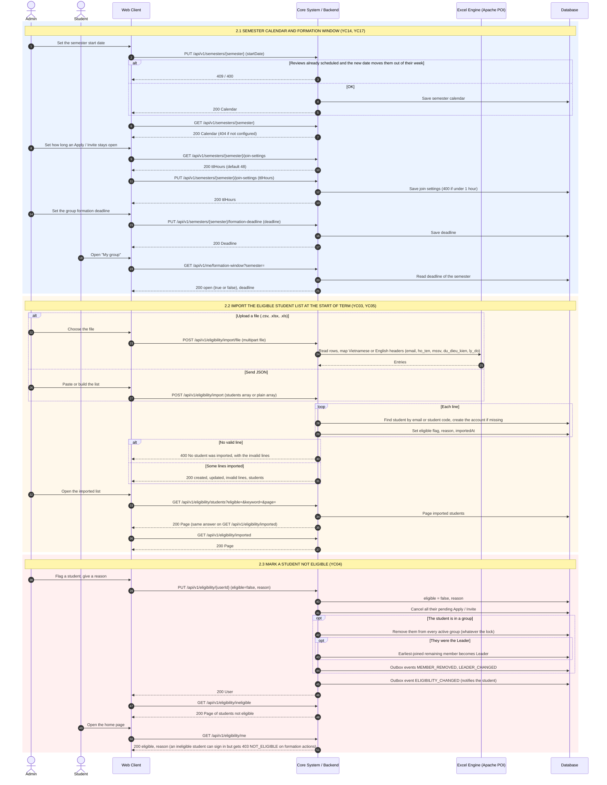

# 2. Thiết lập học kỳ và danh sách sinh viên đủ điều kiện

Swagger tag: **Semesters** (2), **Eligibility** (7), và 4 API cấu hình thời hạn của **Group Formation**.

> A deadline only closes the window: after it, Apply, Invite, Accept and leave decisions return 409 to non-Admins.
> The BE has no automatic job that disbands groups under 3 members or cancels requests at the deadline.
