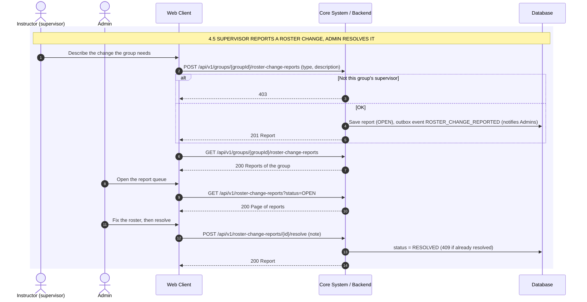

# 4. Lập nhóm: Apply, Invite, ý kiến thành viên, rời nhóm, báo thay đổi

Swagger tag: **Group Formation** (24 API; 4 API thời hạn nằm ở file 2).

Quy tắc chung: sinh viên chỉ vào nhóm khi **chấp nhận Invite** (YC10, YC11). Một nhóm có 3-5 người. Mỗi sinh viên có tối đa 3 Apply đang chờ. Apply/Invite hết hạn sau `ttlHours` (mặc định 48 giờ).

```mermaid
sequenceDiagram
    autonumber
    actor ST as Student
    actor LD as Team Leader
    actor MB as Member
    participant FE as Web Client
    participant BE as Core System / Backend
    participant DB as Database

    rect rgb(238, 252, 238)
    Note over ST,DB: 4.1 STUDENT APPLIES TO A GROUP (YC08, YC09)
    ST->>FE: Click "Apply", write a message
    FE->>BE: POST /api/v1/groups/{groupId}/applications (message)
    BE->>DB: Lock the student row
    alt Not eligible
        BE-->>FE: 403 NOT_ELIGIBLE
    else Deadline passed, already in a group, group full or not recruiting
        BE-->>FE: 409
    else Already applied to this group, or 3 applications pending
        BE-->>FE: 409
    else OK
        BE->>DB: Save APPLY (PENDING, expiresAt = now + ttlHours)
        BE->>DB: Outbox event JOIN_APPLICATION_RECEIVED (notifies the Leader)
        BE-->>FE: 201 Application
    end
    ST->>FE: Open "My applications"
    FE->>BE: GET /api/v1/me/applications
    BE-->>FE: 200 My applications with their status
    opt Student changes their mind
        FE->>BE: POST /api/v1/applications/{id}/withdraw
        BE->>DB: status = WITHDRAWN (409 if no longer pending)
        BE-->>FE: 200 Application
    end
    end

    rect rgb(235, 243, 255)
    Note over ST,DB: 4.2 MEMBERS GIVE AN OPINION, THE LEADER DECIDES (YC10)
    LD->>FE: Open the group's applications
    FE->>BE: GET /api/v1/groups/{groupId}/applications
    BE-->>FE: 200 Applications with the applicant profile
    MB->>FE: Agree or disagree, with a comment
    FE->>BE: POST /api/v1/applications/{id}/votes (vote, comment)
    BE->>DB: Save or replace my vote (403 if not a member)
    BE-->>FE: 200 Vote
    FE->>BE: GET /api/v1/applications/{id}/votes
    BE-->>FE: 200 Votes of the members
    alt Leader approves
        LD->>FE: Click "Approve"
        FE->>BE: POST /api/v1/applications/{id}/approve
        BE->>DB: Lock application and group
        alt Not this group's Leader
            BE-->>FE: 403
        else Not pending, group full, deadline passed, applicant already in a group
            BE-->>FE: 409
        else OK
            BE->>DB: Application APPROVED
            BE->>DB: Create INVITE (or reuse the open one), sourceApplicationId = application
            BE->>DB: Outbox event JOIN_INVITE_RECEIVED (notifies the student)
            BE-->>FE: 200 Invite (the student is not a member yet)
        end
    else Leader rejects
        LD->>FE: Click "Reject", optional reason
        FE->>BE: POST /api/v1/applications/{id}/reject (reason)
        BE->>DB: Application REJECTED, outbox event JOIN_APPLICATION_REJECTED
        BE-->>FE: 200 Application
    end
    end

    rect rgb(255, 248, 235)
    Note over ST,DB: 4.3 LEADER INVITES BY STUDENT CODE, THE STUDENT ANSWERS (YC11, YC13, YC15)
    LD->>FE: Type a student code (MSSV) or email
    FE->>BE: POST /api/v1/groups/{groupId}/invites (studentCode, message)
    alt Student not found
        BE-->>FE: 404
    else Not eligible
        BE-->>FE: 403 NOT_ELIGIBLE
    else Group full, deadline passed, student already in a group, invite already open
        BE-->>FE: 409
    else OK
        BE->>DB: Save INVITE (PENDING, expiresAt), outbox event JOIN_INVITE_RECEIVED
        BE-->>FE: 201 Invite
    end
    FE->>BE: GET /api/v1/groups/{groupId}/invites
    BE-->>FE: 200 Invites sent by the group
    opt Leader takes the invite back
        FE->>BE: POST /api/v1/invites/{id}/revoke
        BE->>DB: status = REVOKED
        BE-->>FE: 200 Invite
    end
    ST->>FE: Open "My invites"
    FE->>BE: GET /api/v1/me/invites
    BE-->>FE: 200 Pending invites
    alt Accept
        ST->>FE: Click "Accept"
        FE->>BE: POST /api/v1/invites/{id}/accept
        BE->>DB: Lock the student row, then the group row
        alt Not my invite
            BE-->>FE: 403
        else Expired or answered, deadline passed, group full, already in a group
            BE-->>FE: 409
        else OK
            BE->>DB: Invite ACCEPTED, add or reactivate the member row
            BE->>DB: Cancel all my other pending Apply / Invite, roster back to DRAFT
            BE->>DB: Outbox event MEMBER_JOINED
            BE-->>FE: 201 Member (the student is now in the group)
        end
    else Decline
        ST->>FE: Click "Decline"
        FE->>BE: POST /api/v1/invites/{id}/decline
        BE->>DB: Invite DECLINED, outbox event JOIN_INVITE_DECLINED
        BE-->>FE: 200 Invite
    end
    Note over BE,DB: Every minute a job marks unanswered Apply / Invite past expiresAt as EXPIRED
    end

    rect rgb(255, 240, 240)
    Note over ST,DB: 4.4 LEAVE THE GROUP (YC21, YC22)
    MB->>FE: Click "Leave group", give a reason
    FE->>BE: POST /api/v1/groups/{groupId}/leave-requests (reason)
    alt Not a member, or no reason
        BE-->>FE: 403 / 400
    else Already asked
        BE-->>FE: 409
    else OK
        BE->>DB: Save leave request (leaderRequest = true if the Leader asks)
        BE->>DB: Outbox LEAVE_REQUESTED to the Leader, or LEADER_LEAVE_REQUESTED to the Admins
        BE-->>FE: 201 Leave request
    end
    FE->>BE: GET /api/v1/groups/{groupId}/leave-requests
    BE-->>FE: 200 Leave requests of the group
    opt Member changes their mind
        FE->>BE: POST /api/v1/leave-requests/{id}/withdraw
        BE-->>FE: 200 Leave request
    end
    alt A member's request: the Leader decides
        LD->>FE: Approve
        FE->>BE: POST /api/v1/leave-requests/{id}/approve
        BE->>DB: Check the roster is not locked and the window is open
        BE->>DB: Request APPROVED, member removed, outbox LEAVE_DECIDED and MEMBER_LEFT
        BE-->>FE: 200 Leave request
    else The Leader's own request: only an Admin decides
        FE->>BE: GET /api/v1/leave-requests?status=PENDING&leaderOnly=true
        BE-->>FE: 200 Pending Leader requests
        FE->>BE: POST /api/v1/leave-requests/{id}/approve (newLeaderUserId)
        BE->>DB: New Leader set (or earliest-joined member), old Leader removed
        BE-->>FE: 200 Leave request
    else Reject
        FE->>BE: POST /api/v1/leave-requests/{id}/reject
        BE->>DB: Request REJECTED, outbox LEAVE_DECIDED
        BE-->>FE: 200 Leave request
    end
    end
```

