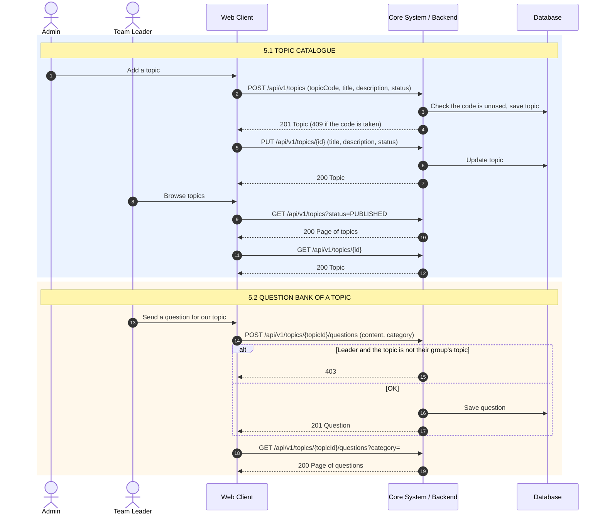
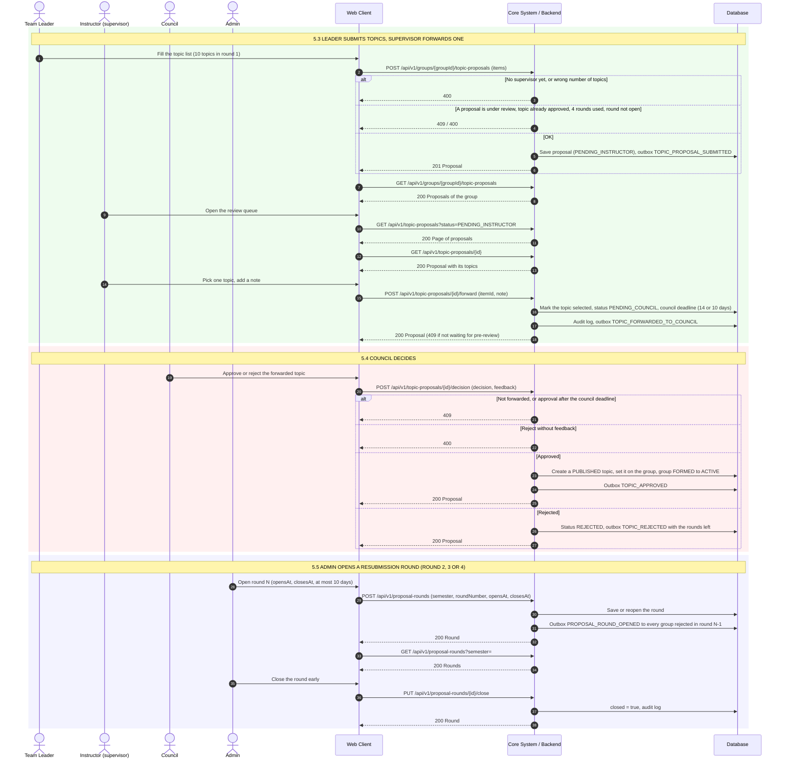

# 5. Đề tài, ngân hàng câu hỏi và duyệt đề tài

Swagger tag: **Topics** (4), **Question Bank** (2), **Topic Proposals** (9).

> Phần này dùng vai trò Instructor và Council. Hai vai trò này nằm ngoài phạm vi 3 vai trò (Student, Leader, Admin) của đợt lập nhóm, nhưng API vẫn có trên Swagger.

