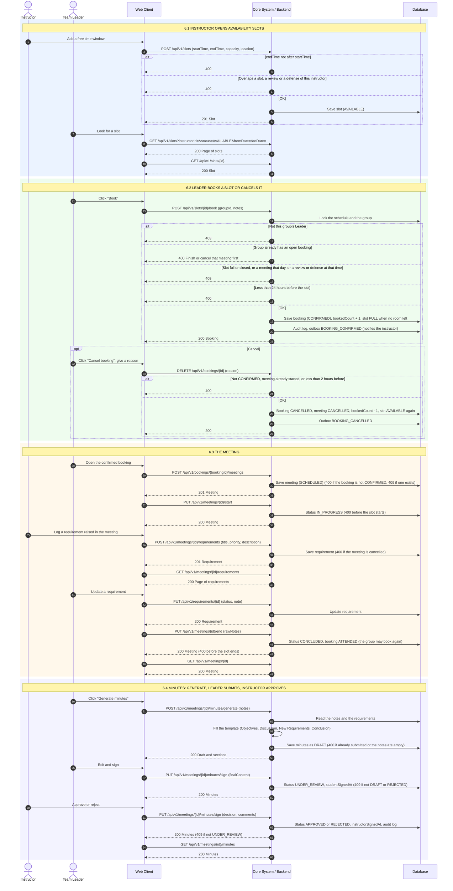

# 6. Lịch rảnh, đặt lịch, buổi họp, biên bản và yêu cầu

Swagger tag: **Schedule Slots** (3), **Bookings** (2), **Meetings** (4), **Meeting Minutes** (3), **Requirement Logs** (3).

> Phần này dùng vai trò Instructor, nằm ngoài phạm vi 3 vai trò của đợt lập nhóm.

