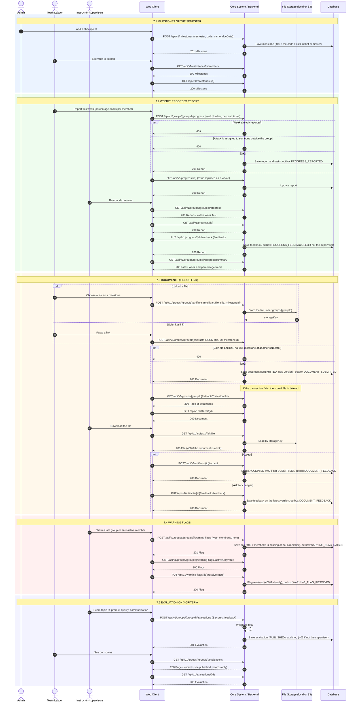

# 7. Mốc nộp, tiến độ tuần, tài liệu, cảnh báo và chấm điểm

Swagger tag: **Milestones** (3), **Weekly Progress** (6), **Documents** (6), **Warning Flags** (3), **Evaluations** (3).

> Phần này dùng vai trò Instructor, nằm ngoài phạm vi 3 vai trò của đợt lập nhóm.

